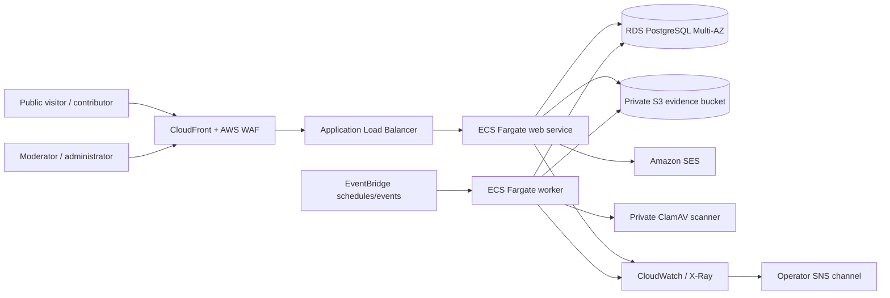
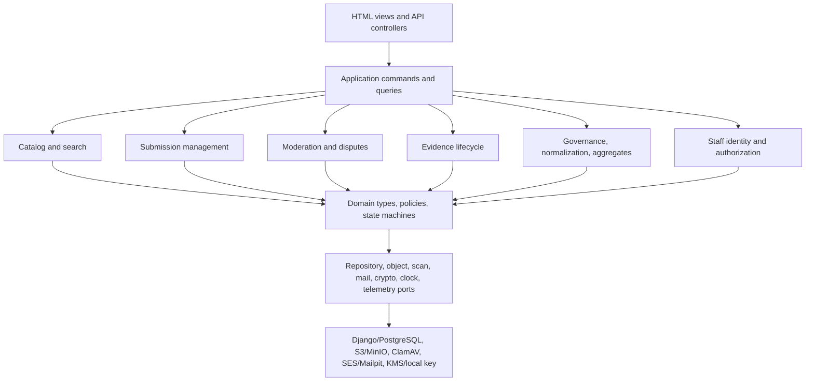
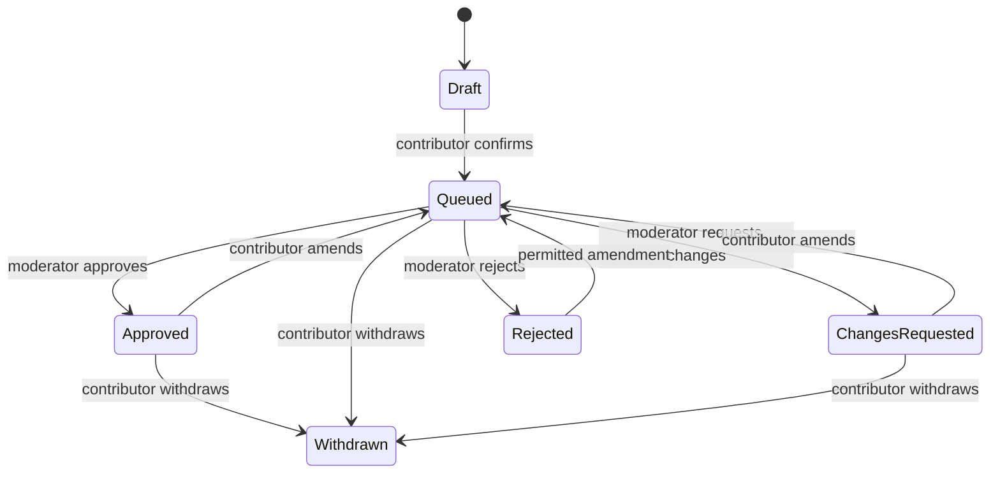
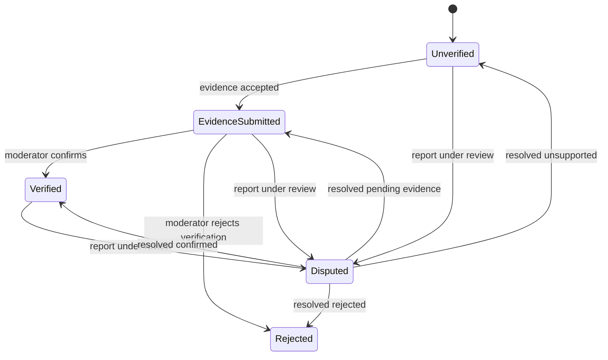
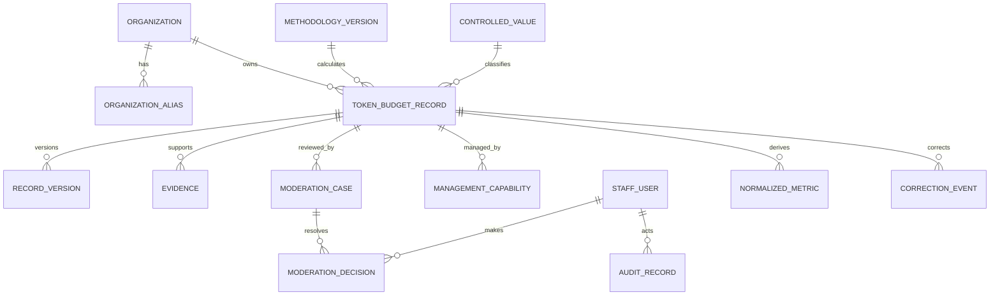

# Technical Design Document

## Overview

Token Budget Platform will be a public, searchable benchmark and contribution service implemented as a modular monolith. The design preserves the approved scope: token allowances and related usage/cost context only; no cryptocurrency, compensation, authentication-token, or context-window data. Anonymous visitors can browse and report records, contributors can submit and manage one record through an unguessable capability link, and authenticated staff can moderate and administer the dataset.

The design optimizes for correctness and operability before service decomposition. One application image serves accessible server-rendered HTML and versioned JSON APIs; the same codebase supplies background commands for scanning, retention, aggregation, and notifications. PostgreSQL is the system of record. Evidence is encrypted in object storage and inaccessible until scanning succeeds. Explicit public-view serializers prevent private fields from crossing the publication boundary.

### Goals and boundaries

- Preserve all approved workflows and privacy constraints in Requirements 1–16 without adding public contributor accounts, social features, payment processing, or model-provider integrations.
- Run every core journey locally without AWS credentials or paid services and deploy the same image to AWS.
- Support 1,000,000 published records and 100 public reads/second with indexed PostgreSQL queries, conservative caching, horizontal web scaling, and measurable SLOs.
- Prefer boring, well-supported technology and replaceable ports over managed-service behavior embedded in domain rules.
- Treat evidence, management capabilities, email, free text, and staff activity as sensitive by default.

### Selected technology stack

| Concern | Selection | Rationale |
|---|---|---|
| Language/runtime | Python 3.13, pinned image and lockfile | One mature language for web, domain logic, workers, tests, and infrastructure; excellent debugger and property-testing support. |
| Web framework | Django 5.2 LTS with Django REST Framework | Built-in forms, CSRF, ORM, migrations, authentication, admin primitives, and secure template escaping reduce custom security code. Django 5.2 has long-term security support ([Django 5.2 release notes](https://docs.djangoproject.com/en/5.2/releases/5.2/)). |
| UI | Django templates, semantic HTML, progressive enhancement with vendored HTMX, small TypeScript modules only where necessary, modern CSS | Server rendering makes public pages fast, crawlable, resilient, and straightforward to test for accessibility. Core read and form journeys remain usable without client-side state. |
| Database/search | PostgreSQL 16 on local Docker and Amazon RDS Multi-AZ; B-tree, GIN, and `pg_trgm` indexes | Relational constraints fit moderation/version history; one datastore simplifies local parity. `pg_trgm` supplies indexed case-insensitive containment search ([PostgreSQL documentation](https://www.postgresql.org/docs/current/pgtrgm.html)). |
| Background work | PostgreSQL outbox/job table plus idempotent Django worker process | Avoids Redis/SQS as another required dependency. Transactional enqueueing, `FOR UPDATE SKIP LOCKED`, leases, retries, and persisted outcomes are sufficient for this workload. |
| Evidence | MinIO locally; private versioned Amazon S3 bucket in AWS; ClamAV scanning service in both environments | S3-compatible local behavior and the same storage adapter; upload passes through the application so the evidence store never has a public route. |
| Email | Mailpit locally; Amazon SES in AWS through a `NotificationPort` | Capturable local notifications and no paid dependency for development. |
| Authentication | Django session authentication, Argon2id passwords, TOTP MFA, recovery codes, DB-backed exact lockout and RBAC | Identical local/AWS behavior and exact control of the five-attempt/15-minute policy without relying on provider-specific semantics. No public contributor account is introduced. |
| Packaging/local | OCI images and Docker Compose | One documented cross-platform start command on Docker Desktop/Engine; source mounts and debug ports preserve original source locations. |
| AWS runtime | CloudFront + WAF + ALB, ECS Fargate web/worker/scanner tasks, RDS PostgreSQL, S3, KMS, SES, CloudWatch/SNS | Managed containers avoid host maintenance; Fargate runs containers without provisioning servers ([AWS ECS documentation](https://docs.aws.amazon.com/AmazonECS/latest/developerguide/AWS_Fargate.html)). |
| Infrastructure | AWS CDK in Python, synthesized and policy-checked in CI | One language, reviewable version-controlled infrastructure, and pre-deployment assertions for network/privacy invariants. |
| Tests | pytest, pytest-django, Hypothesis, Playwright, axe-core | Fast examples plus generated invariants and real-browser accessible journeys. Hypothesis targets guarantees over broad generated input spaces ([Hypothesis documentation](https://hypothesis.readthedocs.io/en/latest/)). |

Use exact dependency versions and image digests in `uv.lock`, vendored frontend assets, and container manifests. Upgrade through reviewed dependency changes rather than floating production tags.

### Research findings informing the design

- Django’s deployment guidance distinguishes environment-specific settings while emphasizing security, performance, and operational checks; this supports a single codebase with validated external configuration ([deployment checklist](https://docs.djangoproject.com/en/5.1/howto/deployment/checklist/)).
- Fargate and ECS blue/green deployments support managed container execution, pre-traffic validation, and rollback to the prior revision, matching the reproducibility and health rollback requirements ([ECS blue/green deployments](https://docs.aws.amazon.com/en_us/AmazonECS/latest/developerguide/deployment-type-blue-green.html)).
- RDS PostgreSQL supports VPC placement, Multi-AZ, encrypted storage, backups, and point-in-time recovery; customer-managed KMS keys satisfy owner-controlled encryption ([RDS PostgreSQL](https://docs.aws.amazon.com/AmazonRDS/latest/UserGuide/CHAP_PostgreSQL.html), [RDS encryption](https://docs.aws.amazon.com/AmazonRDS/latest/UserGuide/Overview.Encryption.html)).
- Native semantic tables retain header/data relationships for assistive technology, so comparisons and chart equivalents use real HTML tables rather than ARIA grids ([W3C table guidance](https://www.w3.org/WAI/tutorials/tables/)). WCAG 2.2 focus visibility requirements also shape sticky-header and dialog behavior ([WCAG 2.2 changes](https://www.w3.org/WAI/standards-guidelines/wcag/new-in-22/)).

Content from linked sources was rephrased for licensing compliance.
## Architecture

### Context and deployment shape



Locally, CloudFront/WAF/ALB are omitted, the same web and worker images run in Docker Compose, PostgreSQL replaces RDS, MinIO replaces S3, Mailpit replaces SES, and a ClamAV container supplies the same scan protocol. AWS-specific deployment tests are separate; domain behavior is unchanged because storage, notification, clock, encryption, and backup-state dependencies are ports.

### Modular-monolith boundaries



Module imports point inward: transport and adapters may depend on application/domain modules, never the reverse. All HTML and JSON endpoints call the same commands, validators, authorization policies, normalization functions, and public projection builders. Database constraints provide a final integrity boundary.

### Primary request and event flows

**Public read:** CloudFront caches only anonymous GET/HEAD responses whose URL fully describes search/filter/sort/cursor state. WAF and ALB forward misses to Django. `PublicRecordQuery` applies mandatory publication/suppression predicates, stable indexed ordering, cursor pagination, and explicit public DTO serialization. Private models are never passed directly to templates or DRF serializers. Changes publish cache-invalidation jobs; short TTLs bound stale reads if invalidation fails.

**Submission:** Django validates a draft on each step and stores server-side draft state with an expiry. Preview is generated from the same `PublicRecordDTO` allowlist used after publication. Confirmation atomically creates the record, immutable initial version, moderation case/queue item, hashed management capability, and outbox jobs. The returned reference identifier is random and non-public.

**Management link:** The link is `/manage/#capability=<256-bit token>`, keeping the secret out of HTTP access logs and referrers. A small first-party script POSTs it once to `/api/v1/management-sessions`; the server compares a keyed hash, rotates the capability when appropriate, issues a short-lived Secure/HttpOnly/SameSite=Strict scoped session, and redirects to a clean URL. The page explains a script-blocked recovery path. Raw capability values are never stored or logged.

**Evidence:** The web process accepts at most 10 MiB, checks declared and detected allowlisted types, encrypts the stream with a per-evidence data key, and writes it to a private quarantine prefix through a VPC endpoint in AWS. It records `PENDING_SCAN` and a durable scan job in one database transaction. The worker decrypts only into a bounded stream, sends it to private ClamAV, records a security event, and transitions to `CLEAN`, `QUARANTINED`, or `SCAN_ERROR`. Moderator download is an authenticated application response available only for `CLEAN`; no object URL is exposed.

**Moderation:** Commands lock the target row, verify role/resource authorization and expected version, apply the transition, and commit. Audit creation runs immediately after the privileged transaction in an independent transaction because Requirement 7 explicitly says audit failure must not undo the action. Failure emits a sanitized high-severity operational event containing actor surrogate, action, target surrogate, and correlation ID but no submitted content.

**Privacy emergency:** A Personal_Data/Sensitive_Data community report synchronously sets `suppressed_at` before returning success, preventing all public queries; a high-priority job purges caches. Moderator-confirmed exposure creates redacted content/version data and keeps prior sensitive versions inaccessible. Submission/evidence cryptographic erasure destroys per-record wrapped keys so retained backups cannot recover deleted personal content.

**Backup gate:** AWS Backup/RDS events update a signed backup-state record consumed by the application. A required backup failure closes the global mutation gate; middleware and command handlers reject all production data-changing operations except health, backup recovery, and narrowly authorized operational actions. A succeeding required backup reopens it. Local and tests use a deterministic adapter.

### Consistency, concurrency, and scale

- PostgreSQL transactions and optimistic `row_version` prevent lost moderation or contributor updates. State-changing commands accept an idempotency key and persist the result for replay-safe retries.
- Search uses normalized lowercase columns, `pg_trgm` GIN indexes for containment, B-tree composite indexes for filters/order, and seek cursors containing sort value plus UUID. Cursors are signed, versioned, and reject changed criteria.
- Public count queries use the same predicate as result queries. Frequently requested aggregate groups are precomputed in `AggregateSnapshot`; groups below three are never persisted as public aggregates.
- Token values are integer `numeric(30,0)` values. Derived values use `Decimal` with an explicit 18-digit precision and half-even display rounding; calculations never use binary floating point.
- Web tasks are stateless apart from signed sessions. At least two production tasks span availability zones; autoscaling uses request count, CPU, and p95 latency. Database connection limits are enforced per task.
- Worker jobs are at-least-once. Lease expiry recovers crashed work; every handler is idempotent and records attempts, next run, sanitized failure category, and terminal status.

### State machines



`publication_state` is separate from `verification_status`. Approval controls visibility; verification communicates evidence confidence. Public eligibility is `publication_state = APPROVED AND withdrawn_at IS NULL AND suppressed_at IS NULL`.



The case stores `status_before_dispute`, and resolution must choose an allowed resulting status. A sensitive report additionally suppresses public visibility; other reports show `Disputed` while under review.
## Components and Interfaces

### Web presentation and public catalog

- **Page controllers** render landing, browse, compare, organization, record, methodology, retention, submission, management, report, and staff pages. Templates use semantic landmarks, one `h1`, unique titles, escaped text, CSRF tokens, and reusable form/error components.
- **`PublicRecordQuery`** accepts `SearchCriteria`, produces `Page[PublicRecordDTO]`, and owns publication predicates, filters, sorting, signed cursors, count, stale flag, and status definitions.
- **`ComparisonService`** accepts 2–5 distinct published IDs, preserves requested order, returns aligned rows, source values, formulas, missing-input reasons, and both original and normalized values.
- **`OrganizationQuery`** resolves canonical aliases and returns organization metadata, eligible records, and only aggregates meeting the minimum group size.
- **`PublicProjectionBuilder`** is the sole private-to-public boundary. It copies an enumerated allowlist and rejects unknown fields; contact data, capability material, evidence, internal team names, private notes, and unreviewed free text have no public DTO field.

### Submission and validation

- **`SubmissionValidator`** is pure domain code shared by HTML forms, JSON APIs, preview, and persistence. It validates Unicode-normalized bounded strings, controlled-value IDs, date order/timezone, source date, integer token/count ranges, ISO 4217 currency, optional-field coherence, and allocation totals.
- **`SubmissionService`** creates drafts, previews exact publishable data, confirms records, computes duplicate fingerprints, creates references and management capabilities, amends with version history, withdraws, and requests privacy erasure.
- **`CapabilityService`** creates 256-bit random tokens, stores versioned HMAC hashes, compares in constant time, enforces expiry/revocation/scope, rotates tokens, and exchanges them for record-scoped sessions.
- **`DuplicateDetector`** canonicalizes organization, scope, product, token budget, and period into a versioned fingerprint. A match sets a review flag; it never automatically rejects a submission.

Documented submission bounds are inclusive unless stated: token budget and optional usage `1..10^30-1`; seat/workload count `1..10^9`; money `0..10^18` minor units with ISO currency exponent; reporting start not after end; period at most 3660 days; source date not in the future; names 1–200 characters; explanations/methodology 1–4000; URLs HTTPS and at most 2048 characters. Input/output token allocations, when both known, are non-negative and sum exactly to the total budget. The implementation may tighten a bound only through an approved requirements change.

### Moderation, governance, and evidence

- **`ModerationService`** provides queue claim/release, approve, reject, request changes, discrepancy requests, report creation, sensitive suppression, dispute resolution, correction, organization merge, and verification decisions. Every command declares allowed roles and source states.
- **`AuditSink`** appends immutable privileged-action records. Database permissions deny update/delete to the application role; retention export/deletion uses a separately controlled maintenance role only after 365 days.
- **`EvidenceService`** enforces maximum size, extension/MIME/signature allowlist, streaming encryption, scan gating, moderator-only access, rejection reason, legal hold, and scheduled erasure. Initial allowlist: PDF, PNG, JPEG, UTF-8 plain text, and CSV; archives, executable formats, macro-enabled documents, and active HTML are rejected.
- **`ControlledVocabularyService`** versions providers, products, workload categories, size bands, regions, and aliases. Existing records retain referential validity; new submissions see only active values.
- **`OrganizationMergeService`** redirects aliases and reassigns records in one transaction while preserving record IDs, versions, cases, and audit targets.
- **`NormalizationService`** returns value, formula identifier/version, source values, and missing inputs. It never silently imputes counts or dates.
- **`AggregateService`** groups by documented dimensions and computes count/min/max/median from eligible records only. A group with count below three returns a suppression explanation, not statistics.

### Normalization rules

Let `days = (period_end - period_start) + 1` in the record timezone, so same-day periods equal one day.

- Every record with valid dates: `budget_30d = token_budget * 30 / days`.
- Individual, team, and organization scopes with `seat_count`: `tokens_per_seat_30d = token_budget * 30 / (seat_count * days)`.
- Workload scope with `workload_count`: `tokens_per_execution = token_budget / workload_count`; the response also includes `budget_30d` for period-length comparison.
- Usage uses equivalent formulas only when usage and required denominator exist. Cost remains in submitted currency/basis; no exchange-rate conversion is implied.
- The active `methodology_version` and formula/source values accompany every normalized response. A rule change creates a new version and queues deterministic recalculation.

### Infrastructure ports

```python
class ObjectStorePort(Protocol):
    def put_encrypted(self, key: str, stream: BinaryIO, metadata: ObjectMetadata) -> None: ...
    def open_encrypted(self, key: str) -> ContextManager[BinaryIO]: ...
    def delete(self, key: str) -> None: ...

class MalwareScannerPort(Protocol):
    def scan(self, stream: BinaryIO) -> ScanResult: ...

class NotificationPort(Protocol):
    def send(self, message: Notification) -> DeliveryReference: ...

class KeyManagementPort(Protocol):
    def generate_data_key(self, purpose: str) -> WrappedDataKey: ...
    def decrypt_data_key(self, wrapped: WrappedDataKey) -> bytes: ...
    def destroy_reference(self, key_id: UUID) -> None: ...

class BackupGatePort(Protocol):
    def mutation_allowed(self) -> GateDecision: ...
```

Production adapters use S3/KMS/SES/signed backup events; local adapters use MinIO, an ephemeral development master key outside version control, Mailpit, and a deterministic gate. Contract tests run against both adapter families where feasible.

### API surface

All JSON endpoints are under `/api/v1`, use `application/problem+json` errors, UUID identifiers, ISO-8601 dates/times, decimal values serialized as strings, request correlation IDs, and explicit schemas. State-changing requests require CSRF for browser sessions, an `Idempotency-Key`, and optimistic `If-Match` where concurrent edits are possible.

| Method and path | Access | Purpose |
|---|---|---|
| `GET /records` | Public | Search/filter/sort/count/cursor over published records. |
| `GET /records/{id}` | Public | Public record, status definition, staleness, methodology. |
| `GET /organizations/{slug}` | Public | Canonical profile, records, eligible aggregates. |
| `GET /comparisons?record=id...` | Public | Aligned 2–5 record comparison and normalized metrics. |
| `GET /controlled-values` | Public | Active submission/filter vocabularies and versions. |
| `POST /submission-drafts` | Public, rate limited | Create expiring server-side draft. |
| `PATCH /submission-drafts/{id}` | Draft capability | Validate/update a step. |
| `POST /submission-drafts/{id}/preview` | Draft capability | Return exact `PublicRecordDTO` preview. |
| `POST /submission-drafts/{id}/confirm` | Draft capability | Create one queued record/reference/management token. |
| `POST /records/{id}/evidence` | Management session | Stream one evidence item; multiple calls allow multiple items. |
| `POST /management-sessions` | Capability token | Exchange fragment token for scoped session. |
| `GET/PATCH/DELETE /managed-submissions/{reference}` | Management session | View, amend, or withdraw, including withdrawn state. |
| `POST /managed-submissions/{reference}/recovery` | Public, rate limited | Non-enumerating email recovery response. |
| `POST /managed-submissions/{reference}/privacy-erasure` | Management session | Start deletion/anonymization workflow. |
| `POST /records/{id}/reports` | Public, rate limited | Create categorized moderation case; sensitive categories suppress synchronously. |
| `GET /staff/moderation-cases` | Moderator/Admin | Queue with lease and filters. |
| `POST /staff/moderation-cases/{id}/decisions` | Moderator/Admin | Approve/reject/request change/resolve with reason. |
| `GET /staff/evidence/{id}` | Moderator/Admin | Stream only clean evidence after authorization. |
| `POST /staff/organizations/{id}/merge` | Moderator/Admin | Merge into canonical profile. |
| `POST /staff/controlled-values` | Administrator | Version controlled vocabulary values. |
| `GET /health/live` | Infrastructure | Process liveness only. |
| `GET /health/ready` | Public/Infrastructure | Readiness, deployment version, coarse dependency status; no sensitive data. |

HTML routes mirror these capabilities and use the same application services. OpenAPI is generated from checked-in schema definitions and validated in CI. Pagination cursors and comparison IDs are URL encoded, making public state shareable.
## Data Models

All mutable tables use UUIDv7 primary keys, UTC `created_at`/`updated_at`, and `row_version`. Date-only reporting values remain dates plus an IANA timezone. Enumerations are database check constraints as well as domain enums. Foreign-key deletion is restrictive unless an explicit retention workflow applies.



### Core entities

**Organization** — `id`, canonical `name`, `slug`, `industry`, size-band controlled value, region controlled value, merge target, active flag. Canonical-name normalized uniqueness prevents accidental duplicates; aliases may map many submitted spellings to one profile.

**ControlledValue** — `id`, `kind`, stable `code`, display label, parent/provider relation where applicable, active-from/to, vocabulary version. Historical references remain valid after deactivation. `OrganizationAlias` contains normalized alias, organization ID, provenance, and active dates.

**TokenBudgetRecord** — organization; scope; optional seat/workload count; provider/product/workload-category/region controlled values; integer token budget; optional input/output allocations; reporting start/end/timezone; source date; optional usage; optional cost minor units/currency/basis; reviewed publishable methodology notes; contributor attribution enum; moderation/publication state; verification status; duplicate flag; correction/publication/review/withdrawal/suppression timestamps; methodology version; active version; public reference UUID. Constraints enforce coherent counts by scope, dates, allocations, usage/cost groups, and publication state.

**RecordVersion** — record ID, monotonic version, canonical JSON snapshot split into `public_payload` and encrypted `private_payload`, changed-field list, reason, actor type/surrogate, created time. Public output can expose only current allowlisted data and correction date; historical payload is non-public.

**NormalizedMetric** — record ID, metric type, exact decimal value, display scale, formula code, methodology version, canonical source-values JSON, calculated time. Unique on record/type/version. Missing values are represented by a calculation result, not a misleading database row.

**AggregateSnapshot** — dimension key/version, group values, count, min/max/median decimals, source watermark, calculated time. Check `count >= 3`; source record IDs remain non-public operational metadata for reproducibility.

### Contribution and private entities

**SubmissionDraft** — random ID, encrypted draft payload, draft capability hash, expiry, controlled-value versions, validation result version. Expired drafts are erased by retention jobs.

**ManagementCapability** — record ID, HMAC key version and token digest, scope, issued/expires/used/revoked times. Tokens are never stored. `ManagementSession` contains a hash of a short-lived session secret and the one permitted record ID.

**ContributorContact** — record ID, encrypted email, deterministic blind index for exact recovery lookup, wrapped per-record data-key reference, consent purposes, retention timestamps. It has no relationship exposed through public queries.

**Evidence** — record ID, kind (`FILE`, `PRIVATE_LINK`, `EXPLANATION`), private object key or encrypted content, filename/MIME/byte count, wrapped data-key reference, scan state/result/signature version, submitted/scanned/final-resolution/delete-due/deleted timestamps, legal-hold flag. Clean state is mandatory for moderator file access; all states are absent from public payloads except their effect on verification status.

### Moderation, identity, and operations

**ModerationCase** — record ID, source (`SUBMISSION`, `REPORT`, `DISPUTE`, `DUPLICATE`, `VERIFICATION`), category, encrypted explanation/private notes, state, priority, previous verification status, claimant surrogate, assigned staff, lease expiry, opened/resolved times. A partial unique index prevents multiple open dispute cases of the same category when inappropriate.

**ModerationDecision** — case ID, action, structured reason code, encrypted rationale, staff ID, resulting publication and verification states, created time. Decisions are append-only.

**CorrectionEvent** — record ID, optional version ID, public correction date, material-value-changed flag, private reason, actor, created time. A correction date may exist without a changed benchmark value.

**StaffUser** — username, Argon2id password hash, role (`MODERATOR`, `ADMINISTRATOR`), active flag, MFA secret encrypted under KMS/local key, recovery-code hashes, failed-attempt window/count, locked-until, session revocation epoch. There are no public contributor users.

**AuditRecord** — immutable sequence/UUID, actor staff surrogate and role, action, target type/ID, timestamp, outcome, correlation ID, source network pseudonym, sanitized metadata. No evidence, email, capability, submitted free text, or credentials are allowed. Database grants and triggers reject update/delete by runtime roles.

**SecurityEvent** — type, timestamp, correlation ID, actor/network pseudonym, target surrogate, outcome/category, scan-engine version, sanitized metadata. Retention and access differ from application logs.

**Job** — type, versioned JSON payload containing identifiers only, state, priority, attempts/max attempts, available/lease times, worker ID, idempotency key, sanitized last-error category. Unique idempotency keys and leases implement at-least-once work.

**OutboxEvent** — aggregate/type/id, event type/version, identifiers-only payload, created/published times. It is committed with domain changes and translated to jobs/cache invalidations/notifications.

**IdempotencyRecord** — requester scope, key digest, request hash, response status/body reference, expiry. Reuse with a different request hash is rejected.

**OperationalGate** — environment, gate type (`BACKUP_MUTATIONS`), open/closed state, signed source event reference, reason code, observed time. Only the backup monitor identity may update it in production.

### Index and partition plan

- `TokenBudgetRecord`: partial public-eligibility indexes on `(publication_state, suppressed_at, withdrawn_at)`, then composites for each supported sort plus UUID; B-tree filters for controlled IDs/dates/status; GIN trigram indexes on normalized organization/provider/product search text.
- `RecordVersion`, `AuditRecord`, `SecurityEvent`, and completed `Job` rows are range-partitioned monthly for bounded maintenance and retention. Partition operations are privileged and audited.
- Organization/profile and detail reads use covering indexes. Search plans are captured against 1,000,000-row synthetic data in performance CI; a sequential scan on primary public search paths fails the plan check unless explicitly reviewed.
- Every public query starts from a repository method that injects the public eligibility predicate. Integration tests deny raw manager use from public modules.
## Correctness Properties

*A property is a characteristic or behavior that should hold true across all valid executions of a system-essentially, a formal statement about what the system should do. Properties serve as the bridge between human-readable specifications and machine-verifiable correctness guarantees.*

### Redundancy reflection

The prework identified overlapping statements around public fields, normalization, moderation visibility, auditing, version history, and sanitization. The properties below consolidate those overlaps: one public-projection property subsumes separate completeness and secrecy checks; one normalization property covers formula consistency and original-value preservation; visibility transitions share one eligibility invariant; amendment/history/correction behavior is one stateful property; and all structured operational sanitization uses one allowlist property. Search matching, filtering, ordering, and URL codecs remain separate because each can fail independently. Each remaining property provides a distinct invariant.

### Property 1: Public projection is complete and privacy preserving

For all records and private sentinel values, the public projection contains every available approved public field and required provenance field, equals the confirmed preview for unchanged data, and contains no contact, management capability, evidence, exact internal team name, private note, non-public reference, or redacted free-text value.

**Validates: Requirements 1.3, 4.2, 5.6, 5.8, 9.3, 9.5**

### Property 2: Pagination is bounded, complete, and counted

For all eligible result sets and valid criteria, traversing signed pages returns each matching record exactly once, no page contains more than 25 records, and the reported count equals the cardinality of the reference result set.

**Validates: Requirements 1.5, 2.5**

### Property 3: Search equals case-insensitive containment

For all datasets and valid organization, provider, or product terms, search returns exactly the published records whose corresponding normalized searchable field contains the normalized term case-insensitively.

**Validates: Requirements 2.1**

### Property 4: Filters equal predicate intersection

For all datasets and combinations of supported filters, a record is returned if and only if it is publicly eligible and satisfies every selected filter predicate.

**Validates: Requirements 2.2**

### Property 5: Sorts are stable and monotonic

For all result sets and supported sort directions, adjacent results are monotonic by the selected token budget, normalized metric, period end, or verification rank, with UUID as a deterministic final tie-breaker.

**Validates: Requirements 2.3**

### Property 6: Shareable URL state round-trips

For all valid search/filter/sort/page states and all valid ordered comparison sets, decoding the canonical encoded URL reproduces an equivalent state or ordered set of identifiers.

**Validates: Requirements 2.4, 3.6**

### Property 7: Comparison selection and alignment are exact

For all distinct identifier lists, comparison accepts exactly 2–5 publicly eligible records and, when accepted, returns the requested records in order with one aligned value or explicit unavailable marker for every documented comparison field.

**Validates: Requirements 3.1, 3.2**

### Property 8: Normalization is exact and preserves sources

For all valid complete records, normalization uses the one formula identified by the active methodology version for that scope, calculates exact Decimal 30-day/per-seat/per-execution values from inclusive period days, and returns unchanged original values plus the exact source inputs and formula identifier.

**Validates: Requirements 3.3, 3.5, 12.7, 14.4**

### Property 9: Missing normalization inputs are explicit

For all records missing any subset of inputs required by their scope formula, the metric is unavailable and the reported missing-input set equals exactly the absent required inputs; no value is imputed.

**Validates: Requirements 3.4, 14.4**

### Property 10: Aggregates are accurate only above the privacy threshold

For all eligible comparison groups, groups of at least three expose count, minimum, maximum, and median equal to a sorted reference model, while groups of zero through two expose no statistic and identify the minimum-size rule.

**Validates: Requirements 4.3, 4.4**

### Property 11: Staleness follows the calendar boundary

For all reporting-period end dates and observation dates, a record is stale if and only if the observation date is later than the end date plus 12 calendar months under the documented month-clamping rule.

**Validates: Requirements 4.5**

### Property 12: An open dispute controls public verification status

For all published records and prior verification statuses, opening a community-report dispute makes the public status Disputed and keeps it Disputed until an allowed resolution restores or changes the underlying status.

**Validates: Requirements 4.6**

### Property 13: Validation rejects precisely with corrective errors

For all generated submission payloads, the validator accepts payloads satisfying every documented type, range, format, date, controlled-value, and coherence rule; otherwise it rejects and returns a corrective error for every invalid or missing field without losing valid sibling fields.

**Validates: Requirements 5.4, 5.5, 14.5**

### Property 14: Confirmation is atomic and idempotent

For all valid previews and repeated confirmation requests sharing an idempotency key, exactly one Unverified record, initial version, linked queue case, unique non-public reference, and hashed management capability are created, and retries return the same outcome.

**Validates: Requirements 5.7, 5.8, 7.1, 8.1**

### Property 15: Duplicate flags equal the versioned fingerprint rule

For all new and existing submissions, duplicate review is flagged if and only if their canonical organization, scope, product, token budget, and reporting period fingerprint components are equal; changing only non-key fields does not change that result.

**Validates: Requirements 5.10**

### Property 16: Evidence and verification transitions obey the state machine

For all records, evidence kinds, scan outcomes, moderator decisions, and source states, only documented evidence/verification transitions succeed: accepted evidence moves Unverified to Evidence_Submitted, confirmation moves eligible records to Verified, rejection moves them to Rejected with a contributor-visible reason, and malicious scan results remain Quarantined.

**Validates: Requirements 6.3, 6.6, 6.7, 10.9**

### Property 17: Evidence access requires both role and clean scan state

For all roles, evidence owners, and scan states, evidence content is accessible if and only if the requester is an authorized Moderator or Administrator for the resource and the evidence state is CLEAN.

**Validates: Requirements 6.2, 10.7**

### Property 18: Moderation transitions enforce public eligibility

For all records and independent withdrawal/suppression flags, approval makes a record publicly eligible only when neither flag is present, while rejection makes it absent from browse, search, comparison, organization, detail, and aggregate repositories.

**Validates: Requirements 7.3, 7.4**

### Property 19: Reports create cases and sensitive reports suppress synchronously

For all valid community reports, exactly one linked moderation case is created; for all reports categorized as Personal_Data or Sensitive_Data exposure, the target record is suppressed from every public repository before the command returns.

**Validates: Requirements 7.7, 7.8**

### Property 20: Case resolution is traceable and state-valid

For all open cases and allowed decisions, resolution appends the decision, structured reason, timestamp, and resulting verification status, closes the case, and cannot produce a status disallowed by the case state machine.

**Validates: Requirements 7.9**

### Property 21: Privileged actions attempt immutable audit records

For all authorized privileged commands and outcomes, the system attempts exactly one append-only Audit_Record containing the actor surrogate, role, action, target, timestamp, outcome, and correlation ID but no prohibited content.

**Validates: Requirements 7.10**

### Property 22: Audit failure never rolls back the privileged action

For all authorized privileged commands, injecting any AuditSink failure after the command commit leaves the domain outcome committed and produces a sanitized operational failure event.

**Validates: Requirements 7.11, 7.12**

### Property 23: Authorization matches the role/resource policy

For all combinations of identity, role, action, and resource, authorization returns the explicit policy-matrix decision; every denied moderation request changes no domain state and records a sanitized authorization-failure event.

**Validates: Requirements 7.13, 10.4**

### Property 24: Amendments preserve history and re-enter review

For all valid amendment sequences, benchmark changes append immutable monotonic versions with exact changed fields/timestamps/reasons, set moderation state to Queued, and, after approval, expose only the latest value plus the appropriate public correction date.

**Validates: Requirements 8.4, 12.4, 12.5**

### Property 25: Retention respects age and legal hold

For all evidence and audit records at arbitrary observation times, evidence is deletion-eligible exactly at 365 days after final case resolution unless a legal hold is active, and Audit_Records are never deletion-eligible before 365 days.

**Validates: Requirements 9.7, 10.11**

### Property 26: Operational output is structurally sanitized

For all nested requests, command payloads, exceptions, and sensitive sentinels, operational logs and audit-failure/unhandled-error events contain required allowlisted metadata and contain no credentials, capability values, Personal_Data, Evidence content, or raw private free text.

**Validates: Requirements 7.12, 9.8, 16.5**

### Property 27: Privileged authentication lockout follows the exact window

For all timestamped success/failure attempt sequences, the account state equals a reference state machine: five failures within 15 minutes lock further attempts until 15 minutes after lock, and attempts outside the rolling window do not contribute.

**Validates: Requirements 10.5**

### Property 28: Untrusted text cannot become executable markup

For all accepted or rejected text inputs including generated markup, controls, and boundary lengths, invalid input is rejected with a corrective error and accepted input renders only as inert text under the output context.

**Validates: Requirements 10.6**

### Property 29: Rate limiting is source-scoped and communicates retry time

For all timestamped request sequences and network-source pseudonyms, requests up to the configured submission/report limit are evaluated normally, excess requests from only that source are rejected, and every rejection carries a positive retry interval consistent with window expiry.

**Validates: Requirements 10.10**

### Property 30: Controlled-value versions affect only subsequent submissions

For all controlled-value activation/deactivation histories and draft creation times, each new submission offers the active values at its captured vocabulary version while historical records retain valid references to prior values.

**Validates: Requirements 12.1**

### Property 31: Alias resolution and organization merge preserve identity-linked data

For all valid alias maps and mergeable organization graphs, normalized aliases resolve to the canonical profile, and merging reassigns every associated record while preserving every record ID, version, case, and Audit_Record target/history.

**Validates: Requirements 12.2, 12.3**

### Property 32: Methodology changes deterministically recalculate affected metrics

For all records affected by a new calculation-rule version, recalculation produces the value defined by that version, leaves unaffected metric types unchanged, and exposes the new active methodology version after completion.

**Validates: Requirements 12.8**

### Property 33: Configuration diagnostics enumerate every omission

For all subsets of required local configuration removed from an otherwise valid configuration, startup fails before serving and reports exactly every missing setting plus the example-configuration reference, without printing secret values.

**Validates: Requirements 13.7**

### Property 34: Domain rules are environment invariant

For all generated domain inputs, clocks, and dependency outcomes, local and AWS adapter configurations produce equivalent validation, comparison, normalization, moderation-state, and privacy decisions after environment-specific outputs are normalized.

**Validates: Requirements 15.3**

### Property 35: Infrastructure policy rejects every public path to private storage

For all synthesized deployment graphs, if any ingress/egress route, bucket policy, access point, security group, or endpoint policy creates an unauthenticated public network path to Evidence or Personal_Data storage, deployment validation fails before resource creation.

**Validates: Requirements 15.9**

### Property 36: Backup events gate production mutations safely

For all valid signed backup success/failure event sequences and data-changing commands, a failure closes the production mutation gate, every subsequent non-exempt mutation is rejected without state change, and only a later required-backup success reopens it.

**Validates: Requirements 16.8**

### Property 37: Public failures have safe classified responses

For all expected and unexpected public-request failures, the response contains a correlation identifier and retryable-or-final classification, maps to the documented status code, and exposes no internal exception text or private data.

**Validates: Requirements 16.11**
## Security and Privacy

### Trust boundaries and controls

1. **Internet to edge:** Route 53 points only to CloudFront. CloudFront enforces TLS 1.2+, HSTS, security headers, origin access identity, response-size limits, and WAF managed/common-threat rules plus source-based submission/report limits. The ALB accepts traffic only from the CloudFront-controlled origin path using a rotated secret header and security-group restrictions.
2. **Edge to application:** ALB terminates/re-establishes TLS and forwards a trusted correlation header policy. The web service validates host/origin, uses Secure/HttpOnly/SameSite cookies, CSRF protection, short staff sessions, session rotation after authentication/role change, and strict request/body limits.
3. **Application to data:** Web/worker/scanner tasks have separate least-privilege IAM roles. RDS, S3, and KMS are private; RDS has no public address, S3 Block Public Access and a deny-public bucket policy are mandatory, and application storage traffic uses a VPC endpoint. Security groups permit only explicit service-to-service paths.
4. **Staff boundary:** Staff authentication requires Argon2id password verification and TOTP MFA (or one-time recovery code), then DB-backed role/resource authorization on every protected command. Five failures in 15 minutes produce an exact 15-minute account lock. Administrators provision/disable staff; no self-registration exists.
5. **Sensitive processing:** Evidence and contributor contact use envelope encryption in addition to KMS-backed RDS/S3 encryption. Each record/evidence has a data key wrapped by an environment-specific customer-managed KMS key. Local development uses a generated key in an ignored volume. Key references are destroyable for irreversible anonymization.

Django template auto-escaping is the default. Publishable free text is stored as plain text, Unicode normalized, length bounded, checked for likely secrets/PII, moderator reviewed, and rendered with no `safe` bypass. Content Security Policy defaults to self-only scripts/styles, forbids objects and base URI, and uses nonces where inline bootstrapping is unavoidable. File download responses force attachment, set `nosniff`, and never reflect an untrusted filename into headers without safe encoding.

Secrets live in AWS Secrets Manager/SSM SecureString and ECS task secrets; source, images, logs, CDK outputs, and client bundles contain none. Rotation covers database credentials, Django signing keys with overlap, management-capability HMAC keys, edge-origin secret, and staff recovery codes. CI runs secret and dependency scans. Production debug pages are impossible by configuration validation.

### Privacy model and retention

The public schema is an allowlist, not a filtered private serializer. Contributor email is optional and purpose-bound to notification/recovery. Exact internal team names are not collected as structured fields. Free-text warnings precede entry; probable PII/secret findings block confirmation pending correction or explicit moderator handling. Network identifiers used for abuse controls are keyed pseudonyms with short retention rather than raw addresses where operationally feasible.

The published retention page is generated from version-controlled policy data and covers drafts, submissions, evidence, contributor contact, moderation cases, operational/security logs, backups, and audits. Initial policy values are configuration with lower bounds enforced by requirements:

| Data | Baseline policy |
|---|---|
| Unconfirmed drafts | Delete 30 days after last activity. |
| Published/withdrawn benchmark and non-personal version history | Retain while part of the benchmark/correction record; withdrawal removes public eligibility. |
| Contributor contact | Keep only while management/recovery purpose remains; erase/anonymize within 30 days of a valid request. |
| Evidence | Delete and crypto-erase 365 days after final related case resolution unless legal hold applies. |
| Moderation cases/decisions | Retain according to published trust-and-safety policy; private content is minimized/redacted. |
| Audit records | At least 365 days; production default 400 days. |
| Operational logs | 30 days by default; security events 400 days, both sanitized. |
| Backups | PITR/daily retention supporting RPO, plus documented production decommission retention; crypto-erased subject data remains unreadable. |

Legal holds require Administrator authorization, reason, scope, expiry/review date, and Audit_Record. Retention jobs operate from database time, are idempotent, record counts rather than content, and alert on overdue items.

## Moderation and Evidence Handling

The moderation queue is a single case abstraction with source-specific forms. Priority order is confirmed/suspected sensitive exposure, malicious evidence/security events, disputes, contributor changes, verification, duplicate review, then ordinary submissions. A lease avoids two moderators deciding concurrently; optimistic version checks reject stale decisions. Queue-age by priority is observable.

Approval and verification are distinct: approval permits publication; verification expresses evidence confidence. A moderator can approve an Unverified or Evidence_Submitted record, and later verification can change confidence without changing benchmark content. Rejection from publication is separate from rejection of an evidence verification request. UI language and APIs expose both axes to avoid conflation.

Every decision requires a structured reason code and may include private rationale. Contributor-visible feedback is separately authored and passed through the same privacy checks as other free text. Benchmark discrepancies cannot be silently corrected by staff: the moderator requests amendment; contributor amendment creates a version and returns the record to review. Correction events after publication retain non-public diffs and expose only the latest value/correction date.

Community reports require category and explanation, are rate limited, and do not reveal reporter identity publicly. Personal/sensitive categories suppress before asynchronous work. Other reports keep the record visible with Disputed status. Resolution can restore the previous status, select another allowed status, redact, reject, or keep the record suppressed. Cache invalidation is defense in depth; canonical database eligibility prevents reappearance.

Evidence has four separable gates: syntactic allowlist/size, encrypted quarantine storage, malware scan, and staff authorization. Scanner timeout/error remains `SCAN_ERROR` and inaccessible, with bounded exponential retry and operator alert; it never defaults clean. Infected content remains quarantined for incident handling until retention/legal-hold policy permits deletion. The security event records digest, engine/signature version, result, and correlation ID, never content. Private links are HTTPS-only, encrypted, never fetched automatically (avoiding server-side request forgery), and opened by authorized moderators through an interstitial warning.

## Local/AWS Parity and Deployment

### Environment matrix

| Capability | Local | AWS | Shared contract |
|---|---|---|---|
| Web/worker | Same OCI image with source mount/debug options | Same immutable ECR image digest on ECS Fargate | Django settings schema and domain services |
| Database | PostgreSQL 16 container | RDS PostgreSQL 16 Multi-AZ | Migrations, constraints, indexes, repository tests |
| Object storage | Private MinIO bucket | Private versioned S3 bucket with SSE-KMS | `ObjectStorePort` contract |
| Malware scan | ClamAV container | Private ECS ClamAV service/tasks | `MalwareScannerPort` protocol/results |
| Mail | Mailpit | SES | `NotificationPort` messages and idempotency |
| Keys | Generated ignored local master key | Customer-managed KMS keys | Envelope format/key interface |
| Edge/rate limits | Django deterministic limiter for test/dev | WAF first layer plus Django safety limit | Same documented limits and response schema |
| Backup gate | Controllable local test adapter | Signed EventBridge/backup monitor state | `BackupGatePort` decision |
| Observability | JSON console logs/local trace viewer | CloudWatch Logs/Metrics, X-Ray/OTel, SNS | Same event schema and redaction |

Planned cross-platform commands are `uv run poe local-up`, `uv run poe reset`, `uv run poe verify`, and `uv run poe deploy --environment <name>`. The task definitions wrap Docker Compose/CDK without shell-specific syntax. `local-up` loads at least 20 deterministic sample records spanning three organizations, three workloads, and all verification statuses. `reset` recreates volumes/buckets, migrations, staff fixtures, keys, and seed data to a checksummed baseline. Missing configuration is validated before containers serve. `.env` contains developer-only values and is ignored; `.env.example` contains names and safe examples only.

Debug mode mounts repository sources, enables `debugpy` on an opt-in localhost port, serves browser source maps for the small TypeScript bundle, and retains original paths in stack traces. It does not weaken production images/settings. The local stack makes no AWS API call and succeeds with credentials removed.

### AWS topology and infrastructure

CDK defines separate `Network`, `Data`, `Runtime`, `Edge`, `Observability`, and `Backup` constructs per environment. Production should use a separate AWS account; at minimum every environment has distinct VPC, subnets, KMS keys, database, bucket, secrets, task roles, log groups, domains, backup vault, and CloudFront distribution. CDK assertions reject wildcard data-plane permissions, public RDS/S3 settings, missing encryption, shared production identifiers, and any public path to private storage.

Web tasks run in private subnets across at least two availability zones. Worker and scanner have no inbound public path. RDS Multi-AZ has automated backups/PITR; AWS Backup adds policy-managed recovery points and retained production decommission backups. S3 versioning/lifecycle protects evidence while respecting application crypto-erasure. CloudFront caches only safe public reads and never staff, submission, management, report, health, or error responses.

A deployment builds once, scans, signs, pushes to ECR, runs migrations as a one-off ECS task, and deploys the digest through ECS blue/green target groups. Migrations follow expand/migrate/contract compatibility so application rollback never requires an unsafe schema rollback. Pre-traffic smoke checks exercise readiness, public detail, and database compatibility. Failed readiness/alarms shift traffic to the last healthy revision automatically. Outputs include public endpoint, image/deployment version, and readiness endpoint.

`deploy` synthesizes and policy-checks before resource creation, then applies one environment. Destructive production changes require an explicit decommission action. Decommission retains production backup vault/recovery points and KMS material according to policy. Recovery creates a clean isolated stack from a valid recovery point, runs integrity/smoke tests, rotates affected credentials, and promotes traffic; quarterly drills verify the four-hour RTO and 24-hour RPO.
## Observability and Operations

Every inbound request receives a validated/generated correlation ID returned in responses and propagated to SQL comments, outbox/jobs, scan calls, notifications, and structured events. Application logs are JSON to stdout with timestamp, severity, deployment version, environment, operation, route template, duration, status, correlation ID, and sanitized error category. They never include raw query strings for management routes, bodies, email, evidence, free text, cookies, authorization values, or capability fragments.

OpenTelemetry instrumentation emits HTTP, database, worker, and external-adapter spans. Production exports through an in-task collector to X-Ray/CloudWatch; local output is console or an optional local trace viewer. Sampling is head-based for normal traffic and retained for errors/slow requests without adding private payloads.

Core metrics include request count/rate/error/latency by route template, active web tasks, DB connections/CPU/storage/replica health, search plan/latency, cache hit rate, job depth/age/retries/failures, moderation queue age by priority, evidence scan outcomes/age, retention overdue count, auth lockouts, rate-limit rejects, storage growth, backup freshness/gate state, and deployment health. Cardinality is bounded: record, user, email, IP, capability, and free-text values are never metric labels.

`/health/live` proves only that the process event loop responds. `/health/ready` returns deployment version and coarse `ok/degraded/unavailable` states for database, object storage, scanner/job processing, and backup mutation gate; it exposes no endpoint names, credentials, content, counts tied to people, or exception text. Public reads may remain ready during noncritical mail degradation; data-changing readiness becomes unavailable when the backup gate is closed.

CloudWatch alarms cover five consecutive one-minute readiness failures and notify SNS within five minutes after the fifth failure, p95 server latency, 5xx rate, low healthy-task count, DB/storage pressure, backup failure/freshness, closed mutation gate, old high-priority moderation cases, scan backlog/errors, and overdue privacy erasure. Alarm delivery is tested. A public status/maintenance notice is separate from internal details; planned outages cannot be scheduled inside 48 hours without an emergency procedure and audit.

Availability is calculated from successful public-read eligible minutes over total Service_Month minutes minus announced maintenance, capped at four excluded hours. A scheduled monthly report records availability, request volume, p50/p95/p99 latency, error rate, moderation queue age, and storage growth from immutable metric queries. The 99.5% target and 2-second p95 at 1,000,000 rows/100 RPS are release/load-test gates and production SLOs, not assumptions.

## Accessibility and Responsive Design

The target is WCAG 2.2 AA for browse, search/filter, compare, details, submission, management, and report journeys. Accessibility is a component acceptance criterion, not a final audit step.

- Server-rendered semantic landmarks, skip link, unique title, exactly one primary heading, descriptive link text, native controls, explicit labels/instructions, and valid heading order are defaults.
- All functionality is keyboard operable. Focus order follows DOM order; focus is never obscured by sticky UI; `:focus-visible` meets contrast/area expectations. Dialogs use native `<dialog>` only with tested focus return and escape behavior, otherwise ordinary pages are preferred.
- Error responses render a focused summary linking to each invalid field; fields use `aria-describedby`, persistent text, and programmatic invalid state. Dynamic HTMX updates announce concise status through a controlled live region and move focus only when user context requires it.
- Filters use fieldsets/legends and submit as ordinary query parameters. Results remain a native table with a small-screen card alternative sourced from the same DOM/data; table overflow may scroll horizontally with instructions, while other content reflows from 320–1920 CSS pixels and at 400% zoom.
- Comparison charts are optional enhancement. The authoritative comparison is an accessible table/text including formulas and source values. Color is never the only status/difference signal; labels/icons have accessible names.
- Reduced-motion, high-contrast/forced-colors, text spacing, target size, autocomplete purpose, language, and timeout/session warnings are included in component review. Management capability exchange reports script failure and recovery accessibly.
- Automated axe-core checks run on every core journey and viewport matrix. Playwright covers keyboard paths and focus assertions. Manual checks cover screen readers, zoom/reflow, focus appearance/obscuring, error recovery, forced colors, text spacing, chart equivalence, and cognitive clarity because automation cannot establish full conformance.

## Error Handling

Domain errors are typed and translated once for HTML and `application/problem+json`. Public errors contain `type`, safe `title`, status, correlation ID, and `retryable`; field errors additionally contain keyed corrective messages. Internal category/stack/context remains in sanitized telemetry only.

| Condition | Response/behavior |
|---|---|
| Invalid field or criteria | 422 with complete field errors; HTML focuses error summary and preserves safe input. |
| Invalid/expired capability | Non-enumerating 404/denial page with recovery action; no distinction between unknown, expired, or revoked. |
| Authentication required/failed | 401 or login page; failures update exact lock state without account enumeration. |
| Authorized identity lacks role/resource access | 403, no state change, sanitized security event. |
| Missing public record | 404; suppressed/rejected/unknown are indistinguishable publicly. |
| Optimistic version mismatch | 412 with reload/review action; never overwrite. |
| Duplicate idempotency key, same request | Replay stored safe result; different request hash returns 409. |
| Rate limit | 429 with `Retry-After`, safe explanation, and no source details. |
| Evidence too large/disallowed | 422, delete partial object, preserve evidence submission opportunity. |
| Scanner unavailable/error | Keep inaccessible `SCAN_ERROR`, retry boundedly, alert; never mark clean. |
| Database/object dependency unavailable | Roll back transaction where possible; 503 retryable; idempotency protects retries. |
| Backup mutation gate closed | 503 retryable for writes, no mutation; public reads continue when safe. |
| Audit append failure | Privileged action remains committed; sanitized high-severity event and metric. |
| Unhandled exception | Safe 500 final/retryable classification by operation, correlation ID, sanitized event. |

Transactions keep record/version/case/outbox changes atomic. External work occurs after commit through jobs. A job handler checks current state and idempotency before acting, uses exponential backoff with jitter, and dead-letters to terminal `FAILED` after its documented attempts; operators can replay by identifier after remediation. Notifications are non-authoritative and never change the moderation result if delivery fails.

## Testing Strategy

### Test layers

- **Unit/example tests:** pure validators, formulas, status/rank mappings, serializers, capability hashing, error translation, retention decisions, and concrete boundary examples. UI component tests cover fixed copy, status definitions, headings, form errors, and accessible equivalents.
- **Property-based tests:** Hypothesis exercises all 37 properties above with generated Unicode, dates/timezones, large integers/Decimals, optional-field subsets, controlled values, role/action matrices, state-machine command sequences, and fault outcomes. Pure logic uses no database; stateful repository properties use isolated PostgreSQL transactions and fake adapters.
- **Integration tests:** real PostgreSQL migrations/constraints/indexes, MinIO encryption/object behavior, ClamAV protocol, Mailpit delivery, worker leases/retries, cache invalidation, staff authentication/MFA, management capability exchange, retention/crypto-erasure, and backup-gate event handling. Testcontainers/Compose dependencies are pinned and isolated per run.
- **API/contract tests:** checked-in OpenAPI schema, public/private DTO separation, problem responses, idempotency, ETag/version behavior, cursor signing, and adapter contract suites.
- **End-to-end tests:** Playwright drives all public, contributor, management, Moderator, and Administrator journeys against deterministic local services. axe-core runs at each material state; keyboard/focus tests are explicit.
- **Infrastructure tests:** CDK snapshots and assertions check topology, TLS, KMS, private storage/networking, least privilege, backups, alarms, environment isolation, outputs, and removal policies. Tagged ephemeral-AWS tests cover deployment, rollback, alert delivery, decommission retention, and restore; normal verification does not require AWS credentials.
- **Performance/resilience tests:** a reproducible 1,000,000-row synthetic dataset and 100-RPS mixed search/detail profile verify p95 at the server boundary, query plans, DB connections, and autoscaling. Fault tests kill web/worker/scanner tasks, expire leases, break audit/notification adapters, and close the backup gate.
- **Security/privacy tests:** static analysis, dependency and container vulnerability scans, secret scan, IaC policy checks, authorization matrix, CSRF/session/header checks, hostile text/file corpus, log sentinel scans, and public-endpoint crawl for private sentinel leakage.

### Property-test rules

Use Hypothesis rather than a custom generator framework. Every correctness property is implemented by exactly one property-based test configured for at least 100 successful examples; stateful tests also set enough steps to cover transition sequences. Each test carries the exact comment/tag:

`Feature: token-budget-platform, Property <number>: <property title/body summary>`

Failures preserve Hypothesis’s minimized counterexample in test output and CI artifacts without sensitive production data. Generators deliberately include valid ranges, zero/one/max boundaries, missing optional values, Unicode normalization, leap dates, tied sort keys, every enum/state, and invalid combinations. Database-heavy integrations remain example based unless the property can run economically with transaction rollback; external AWS behavior is never invoked 100 times.

### Deterministic verification and release gates

`uv run poe verify` is finite and runs formatting check, lint, type check, unit/property tests, integration tests, API/schema tests, Playwright/axe tests, CDK synth/assertions, and report generation in one orchestrated run. It creates isolated schemas/buckets/mailboxes, fixes wall-clock/random external dependencies through injected fakes, and tears them down. AWS-tagged tests skip cleanly when credentials are absent; all non-AWS tests still run.

A releasable artifact is built only after verification, static analysis, dependency/container vulnerability scanning, secret scanning, and IaC policy checks succeed. CI signs the immutable image digest and associates test evidence/SBOM with it. Any failed required check prevents artifact promotion and identifies the check. Manual release approval cannot override a missing artifact.

### Accessibility manual checklist

Before production release and after material component changes, test supported desktop/mobile browsers with keyboard only; NVDA/Firefox and VoiceOver/Safari representative screen readers; 200% and 400% zoom/reflow; forced colors/high contrast; text-spacing overrides; visible/unobscured focus; form error identification/recovery; table navigation; chart/table equivalence; session timeout/recovery; and 320/1920 CSS-pixel bounds. Findings are tracked to closure or documented, time-bounded exceptions.

### Operational acceptance

Staging runs load tests, blue/green rollback injection, five-minute health-alarm delivery, backup restore/RPO marker validation, and privacy erasure/retention dry runs. Production restore drills run quarterly and record elapsed RTO; monthly SLO reports are reviewed. Evidence malware signatures are updated and a harmless standard antivirus test fixture validates the full quarantine/event path without retaining unsafe content.

## Requirement Traceability

| Requirements | Primary design coverage |
|---|---|
| 1–4 | Public catalog/query/projection, comparison/normalization, organization query, aggregate and URL contracts; Properties 1–12. |
| 5–6 | Submission validation/preview/confirmation, capability management, evidence lifecycle; Properties 13–17. |
| 7–8 | Moderation state machines, reports, auditing, contributor management/versioning; Properties 18–24. |
| 9–10 | Public allowlist, encryption/crypto-erasure, retention, sanitization, MFA/RBAC/lockout/rate limits; Properties 1, 17, 23, 25–29. |
| 11 | Accessibility and responsive design plus automated/manual test matrix. |
| 12 | Controlled vocabularies, aliases/merge, immutable versions/corrections, methodology; Properties 24, 30–32. |
| 13–14 | Docker Compose parity, sample/reset/debug/config, deterministic verification, Hypothesis/Playwright/axe and CI gates; Properties 33–34. |
| 15 | CDK deployment, environment isolation, owner keys/private networking, blue/green rollback, retained backups; Properties 34–35. |
| 16 | Multi-AZ runtime, indexed scale plan, health/alerts/metrics, backup gate, RPO/RTO, maintenance and safe errors; Properties 26, 36–37. |
